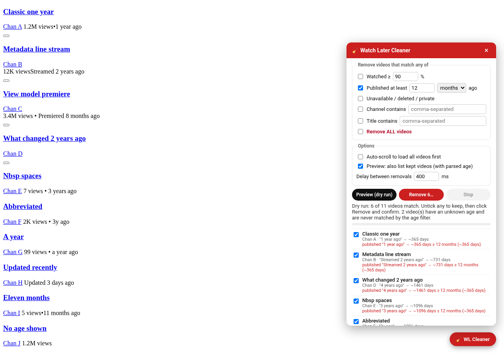
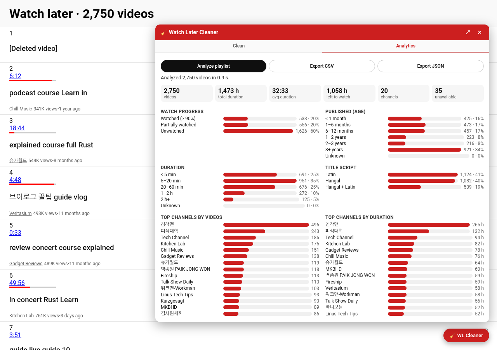

# Watch Later Cleaner

A Chrome extension (Manifest V3) that cleans up your YouTube **Watch Later** playlist
(`https://www.youtube.com/playlist?list=WL`) — remove watched, old, unavailable, filtered, or all videos,
with a dry-run preview before anything is removed.






## Features

- **Remove watched videos** — red progress bar ≥ a configurable threshold (default **90%**).
- **Remove old videos** — published **at least** *N* days / weeks / months / years ago, read from the relative date
  YouTube shows ("3 years ago", "Streamed 2 years ago", "Premiered 8 months ago", "a year ago", "3y ago", …).
  See [How the age filter works](#how-the-age-filter-works). Videos whose age can't be read are never matched.
- **Remove unavailable videos** — `[Deleted video]`, `[Private video]` and similar bracketed entries with no channel.
- **Channel / title keyword filters** — comma-separated, case-insensitive "contains" matching.
- **Remove all.**
- Criteria are combined with **OR** (a video is removed if it matches any enabled criterion).
- **Dry run first:** *Preview* shows the count and the list of matched videos (with the reason each matched).
  Untick anything you want to keep. *Remove* then needs a second **Confirm** click.
- Removal works by **simulating the UI**: each item's **⋮** menu → **Remove from Watch later**, with a configurable
  delay between removals (default **400 ms**), a progress bar/counter and a **Stop** button. Built for long lists (thousands of items):
  - the removal plan is a list of **video IDs**; each video is located fresh by ID right before acting and success is verified by
    that ID disappearing (YouTube re-uses row elements after removals, so element references can't be trusted),
    with YouTube's "Removed from Watch later" toast as a second confirmation;
  - rows are scrolled into view before opening ⋮; a stale/closing popup is closed first;
  - each video gets up to **3 attempts** with backoff; after a failure the delay doubles (up to 5 s) and recovers after successes;
  - it only **pauses** after 8 failed videos in a row; **Resume** continues with the failed + remaining videos without a new preview;
  - **Copy debug log** copies a plain-text log of every attempt (video ID, attempt, the step that failed) for troubleshooting.
- **Auto-scroll** loads the whole playlist before matching (optional).
- **Localization:** the menu entry is found by its English text, then by a localized "remove" verb
  (≈25 languages), then by its trash-can icon, and finally by its menu position (configurable, default 3rd; set 0 to disable).
- **Private and minimal:** no YouTube API key, no network requests, no analytics, no remote code.
  Permissions: `storage` (to remember your settings) and host access to `https://www.youtube.com/*` only.

## Analytics

The panel has two tabs: **Clean** and **Analytics** (the popup's **Analytics** button opens the panel on that tab).
Click **Analyze playlist**: it auto-scrolls to load the whole list (if that option is on) and computes, locally:

- total videos, total / average duration, hours left to watch (duration × unwatched share), channel count, unavailable count;
- watch progress: watched (≥ your threshold) / partially watched / unwatched;
- publish-age distribution: < 1 month, 1–6 months, 6–12 months, 1–2 years, 2–3 years, 3+ years, unknown
  (same lower-bound reading as the age filter, so "1 year ago" is in 1–2 years);
- duration distribution: < 5 min, 5–20 min, 20–60 min, 1–2 h, 2 h+, unknown (live/upcoming have no duration badge);
- title script mix (Latin, Hangul, Hangul + Latin, Japanese, Chinese, Cyrillic, …);
- top 15 channels by number of videos and by total duration — **click a channel** to prefill the Clean tab's channel filter;
- the 5 oldest and 5 longest videos.

**Export CSV / Export JSON** download `position, title, channel, videoId, url, duration, durationSeconds, progressPercent,
publishedText, ageDays, unavailable` (JSON also includes the stats). The CSV has a UTF-8 BOM (Korean titles open correctly
in Excel) and cells starting with `= + - @` are prefixed with `'` to prevent spreadsheet formula injection.
Use **⤢** in the panel header for a wider, two-column layout. Everything is computed in the page; nothing is sent anywhere.
A 2,750-item list is analyzed in about a second.

## How the age filter works

- **Where the age comes from:** each item's `#video-info` spans (classic layout, e.g. `1.2M views` `•` `3 years ago`),
  then `#metadata-line`, the newer `yt-content-metadata-view-model` layout, and finally the title link's `aria-label`
  (with the title stripped, so a title like "What changed 2 years ago" isn't mistaken for the age).
- **Formats:** "N unit(s) ago" with optional "Streamed"/"Premiered"/"Updated", "a/an/one", abbreviations
  (`3y`, `3 yr`, `2mo`, `5 min`), "yesterday", non-breaking/thin spaces, plus German, Spanish, French, Portuguese
  and Italian relative dates. Other UI languages show "age unknown".
- **Units:** week = 7 days, year = 365.25 days, month = year / 12 (≈ 30.44 days), so "12 months" and "1 year" are equal.
- **Inclusive comparison:** YouTube rounds down ("1 year ago" means 12–23 months), so the shown age is a lower bound.
  A video matches when that lower bound is **≥** your threshold: "at least 1 year" (or "12 months") matches "1 year ago"
  but not "11 months ago". Everything matched is therefore truly at least that old.
- **See what was read:** every preview row shows the parsed age, e.g. `"3 years ago" → ~1096 days`, or **age unknown**.
  Tick **Preview: also list kept videos** to see non-matching videos too, with the reason they were kept
  (e.g. `kept: published "11 months ago" → ~335 days < 1 year (~365 days)`).
- It uses the **publish** date; YouTube doesn't show when you *added* a video to Watch Later.

## Install (unpacked)

1. Download `watch-later-cleaner.zip` (or build it — see below) and unzip it into a folder.
   Alternatively, use the `extension/` folder of this repo directly.
2. Open `chrome://extensions`.
3. Turn on **Developer mode** (top-right).
4. Click **Load unpacked** and select the unzipped folder (the one that contains `manifest.json`).
5. Optional: pin **Watch Later Cleaner** from the puzzle-piece menu.

## Usage

1. Open your Watch Later playlist: <https://www.youtube.com/playlist?list=WL> (or click **Open Watch Later** in the popup).
2. Click the red **🧹 WL Cleaner** button in the bottom-right corner of the page (or **Show cleaner panel** in the popup).
3. Pick criteria (watched ≥ %, older than, unavailable, channel/title keywords, or remove all).
4. Click **Preview (dry run)**. The extension scrolls to load all videos and lists what would be removed. Nothing is removed yet.
5. Untick any video you want to keep, click **Remove N…**, then **Confirm: remove N**.
6. Watch the progress counter; click **Stop** at any time (it stops after the current item).
7. If it stops or pauses, click **Resume (N left)** to continue. If failures keep happening, click **Copy debug log**
   and paste it into an issue — it lists which step failed for each video.

Settings are shared between the popup and the on-page panel and saved in `chrome.storage.sync`.

Tips: if YouTube starts lagging or items aren't removed, increase the delay (e.g. 800–1000 ms).
YouTube hides unavailable videos by default; use the playlist's **⋮ → Show unavailable videos** first if you want to remove them.

## Development

Requires Node.js 20+ and Python 3 with Pillow (only for regenerating icons).

```bash
npm install
npm test          # vitest + jsdom: parsing, filtering, simulated menu removal, panel flow
npm run lint      # eslint
npm run build     # -> dist/watch-later-cleaner.zip and dist/extension/
npm run e2e       # headless Chrome smoke test against the local fixture (needs CHROME_PATH or /usr/bin/google-chrome)
npm run icons     # regenerate extension/icons/*.png
```

Layout:

```
extension/            the extension (plain JS, loaded as-is — no bundler)
  manifest.json
  lib/settings.js     defaults, validation, chrome.storage
  lib/parse.js        selectors + parsing of ytd-playlist-video-renderer items
  lib/filters.js      pure matching logic
  lib/remover.js      auto-scroll, ⋮ menu automation, removal loop
  content/panel.js    injected Shadow-DOM panel
  content/main.js     mounts the panel on the Watch Later page (handles YouTube SPA navigation)
  popup/              toolbar popup (settings + shortcuts)
test/fixtures/        hand-written sample Watch Later markup + a fake ⋮ menu used by tests
scripts/              build, e2e smoke test, icon generator
```

The e2e smoke test serves the fixture at the real Watch Later URL via request interception (all other network
requests are blocked), so it never talks to YouTube.

## Limitations

- Relies on YouTube's page structure (`ytd-playlist-video-renderer`, the resume-playback progress bar, the ⋮ popup menu).
  YouTube changes its DOM from time to time; if that happens, selectors in `extension/lib/parse.js` and
  `extension/lib/remover.js` may need updating. The removal loop verifies each removal and stops after repeated failures.
- The age filter uses the video's **publish** date as shown on the page; YouTube doesn't show when you *added* a video.
  Relative dates are understood in English, German, Spanish, French, Portuguese and Italian only.
- Watch progress is only known for videos YouTube shows a red progress bar for.
- Removing hundreds of videos takes a while (delay × count) — that's intentional to avoid tripping YouTube.

## License

MIT
