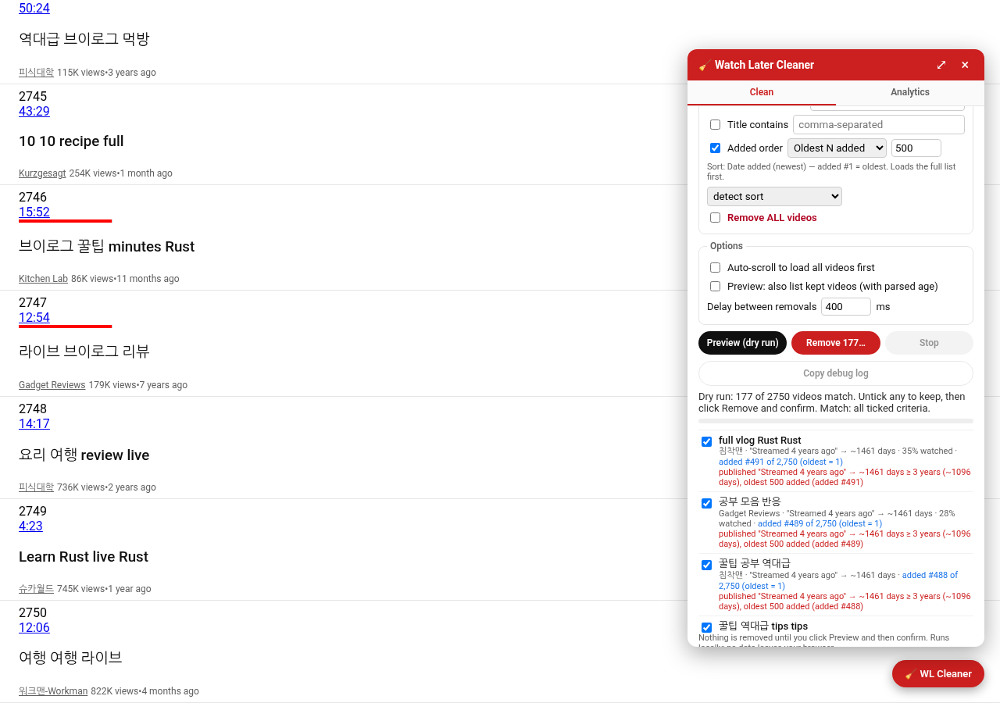
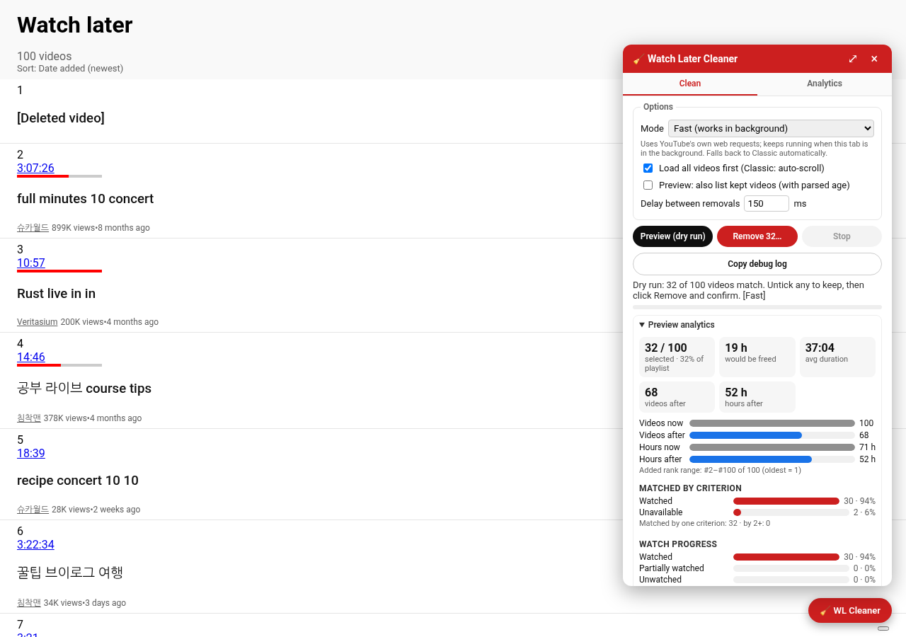
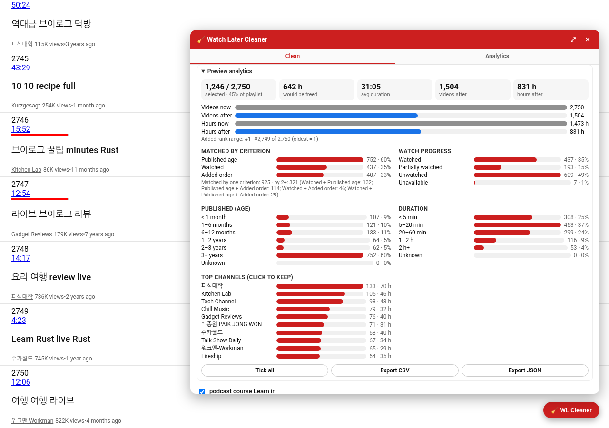

# Watch Later Cleaner

A Chrome extension (Manifest V3) that cleans up your YouTube **Watch Later** playlist
(`https://www.youtube.com/playlist?list=WL`) — remove watched, old, unavailable, filtered, or all videos,
with a dry-run preview before anything is removed.






## Features

- **Remove watched videos** — red progress bar ≥ a configurable threshold (default **90%**).
- **Remove old videos** — published **at least** *N* days / weeks / months / years ago, read from the relative date
  YouTube shows ("3 years ago", "Streamed 2 years ago", "Premiered 8 months ago", "a year ago", "3y ago", …).
  See [How the age filter works](#how-the-age-filter-works). Videos whose age can't be read are never matched.
- **Remove unavailable videos** — `[Deleted video]`, `[Private video]` and similar bracketed entries with no channel.
- **Channel / title keyword filters** — comma-separated, case-insensitive "contains" matching.
- **Added order** — YouTube doesn't show *when* you added a video, but Watch Later can be sorted by **Date added**.
  With that sort active, the extension ranks videos by add order (added #1 = oldest) and offers:
  **Oldest N added**, **Below position #X**, or **Positions #X–#Y** (positions as shown in the list; `0` = to the end).
  - The sort is read from the playlist's sort menu ("Date added (newest|oldest)", with Korean/German/Spanish/French/… fallbacks).
    If the list is sorted any other way, the criterion is disabled with *"Switch the playlist sort to Date added to use this"*.
    If the label can't be read (unusual UI language), you can tell it the order manually.
  - Uses the index numbers YouTube shows (e.g. 836), falling back to list order. "Oldest N added" always loads the full list first
    (on a newest-first list the oldest are at the end) and matches nothing if the list didn't finish loading.
  - Preview rows show e.g. `added #12 of 2,691 (oldest = 1)`. Removal is still by video ID, so positions shifting during removal don't matter.
- **Remove all.**
- **Match any / all** (selector in the criteria header): *any* (default) removes a video matching any ticked criterion;
  *all* requires every ticked criterion, e.g. "oldest 500 added **and** published at least 3 years ago".
- **Dry run first:** *Preview* shows the count and the list of matched videos (with the reason each matched).
  Untick anything you want to keep. *Remove* then needs a second **Confirm** click.
- **Two modes** (Options → *Mode*): **Fast (works in background)**, the default, lists and removes with the same requests
  YouTube's own web page makes, so it keeps going when the tab is in the background. See [Fast mode](#fast-mode-works-in-background-tabs).
  **Classic (page clicks)** scrolls the page and clicks each item's **⋮** menu → **Remove from Watch later**. Classic is also the
  automatic fallback when Fast can't run.
- Both modes remove one video at a time with a configurable delay (default **400 ms**; Fast adds 0–200 ms of jitter), a progress
  bar/counter and a **Stop** button. Built for long lists (thousands of items). Classic specifics:
  - the removal plan is a list of **video IDs**; each video is located fresh by ID right before acting and success is verified by
    that ID disappearing (YouTube re-uses row elements after removals, so element references can't be trusted),
    with YouTube's "Removed from Watch later" toast as a second confirmation;
  - rows are scrolled into view before opening ⋮; a stale/closing popup is closed first;
  - in both modes each video gets up to **3 attempts** with backoff; after a failure the delay doubles (up to 5 s) and recovers after successes;
  - it only **pauses** after 8 failed videos in a row; **Resume** continues with the failed + remaining videos without a new preview;
  - **Copy debug log** copies a plain-text log of every attempt (video ID, attempt, mode, the step that failed) for troubleshooting.
    It never contains cookies or authorization headers.
- **Load all videos first** (optional): Fast mode fetches every page of the list; Classic auto-scrolls the page.
- **Localization:** the menu entry is found by its English text, then by a localized "remove" verb
  (≈25 languages), then by its trash-can icon, and finally by its menu position (configurable, default 3rd; set 0 to disable).
- **Private and minimal:** no analytics, no remote code, no third-party servers. Nothing is sent anywhere except
  `www.youtube.com` itself (Fast mode's requests go there, from the page, like YouTube's own). No API key of ours and no Google sign-in of ours.
  Permissions: `storage` (to remember your settings) and host access to `https://www.youtube.com/*` only. No other permissions.

## Analytics

The panel has two tabs: **Clean** and **Analytics** (the popup's **Analytics** button opens the panel on that tab).
Click **Analyze playlist**: it auto-scrolls to load the whole list (if that option is on) and computes, locally:

- total videos, total / average duration, hours left to watch (duration × unwatched share), channel count, unavailable count;
- watch progress: watched (≥ your threshold) / partially watched / unwatched;
- publish-age distribution: < 1 month, 1–6 months, 6–12 months, 1–2 years, 2–3 years, 3+ years, unknown
  (same lower-bound reading as the age filter, so "1 year ago" is in 1–2 years);
- duration distribution: < 5 min, 5–20 min, 20–60 min, 1–2 h, 2 h+, unknown (live/upcoming have no duration badge);
- title script mix (Latin, Hangul, Hangul + Latin, Japanese, Chinese, Cyrillic, …);
- top 15 channels by number of videos and by total duration — **click a channel** to prefill the Clean tab's channel filter;
- the 5 oldest and 5 longest videos;
- when sorted by Date added: average publish age of the oldest 10% vs newest 10% added.

**Export CSV / Export JSON** download `position, title, channel, videoId, url, duration, durationSeconds, progressPercent,
publishedText, ageDays, unavailable` (JSON also includes the stats). The CSV has a UTF-8 BOM (Korean titles open correctly
in Excel) and cells starting with `= + - @` are prefixed with `'` to prevent spreadsheet formula injection.
Use **⤢** in the panel header for a wider, two-column layout. Everything is computed in the page; nothing is sent anywhere except youtube.com (Fast mode fetches the list from it).
A 2,750-item list is analyzed in about a second.

## Preview analytics
After **Preview** (dry run) on the Clean tab, a collapsible **Preview analytics** block above the list summarizes the videos currently ticked for removal. It reuses the Analytics calculations and charts:

- selected vs total and % of the playlist, hours that would be freed, average duration
- videos and hours **after removal**, with a compact before/after bar chart
- **Matched by criterion** counts. With Match = any it also shows overlap: how many matched one criterion vs 2+, and the most common combinations
- watched / partially watched / unwatched / unavailable among the selection
- publish-age and duration buckets
- added-rank range, when the playlist is sorted by Date added
- top channels in the selection. Click one to **keep** (untick) every video from that channel
- **Tick all**, plus **Export CSV / JSON** of the selected set (same columns as the Analytics export)

It updates live as you tick or untick rows (debounced, one pass), so it stays fast on 2,700+ items. Changing any setting clears the preview and hides the block.



## Fast mode (works in background tabs)

When the YouTube tab isn't focused or visible, Chrome throttles its timers and YouTube stops lazy-loading rows, so scrolling
and clicking (Classic) stalls. Fast mode doesn't depend on either:

- **Listing.** It reads the Watch Later list from the page's initial data (`ytInitialData`), then fetches the remaining pages
  from `/youtubei/v1/browse` continuations, the request YouTube's page makes when you scroll. For each video it reads the video ID,
  the playlist entry ID (`setVideoId`), title, channel, duration, watch progress (resume bar %), unavailable/private state,
  the "3 years ago" text and the position. The same filters, preview and analytics then run on that list.
- **Removal.** Each video is removed with `/youtubei/v1/browse/edit_playlist` (`playlistId: "WL"`, `ACTION_REMOVE_VIDEO` with
  the entry's `setVideoId`; `ACTION_REMOVE_VIDEO_BY_VIDEO_ID` if only the video ID is known). It goes one video at a time, waits for
  each response and counts a removal only when the response is OK **and** reports `STATUS_SUCCEEDED`. Retries, adaptive backoff,
  the pause after 8 failures in a row, Resume and the debug log work as in Classic. Removed rows are taken off the page; reload it
  to refresh the list from YouTube.
- **How the requests are made.** A small script runs in the page's own JavaScript context (a Manifest V3 `world: "MAIN"` content
  script) and makes same-origin requests with the page's own `ytcfg` (`INNERTUBE_API_KEY`, `INNERTUBE_CONTEXT`) and your existing
  YouTube session. It adds the headers YouTube's web client adds: a `SAPISIDHASH` `Authorization` value computed in the page from the
  `SAPISID` cookie and the origin, plus `X-Origin` and `X-Goog-AuthUser`. Cookies and that header stay inside the page script. They
  are never passed to the rest of the extension, stored, logged or sent anywhere but `www.youtube.com`.
- **Background tabs.** The loop moves on when each request finishes, not on a timer. The short pause between videos is timed by
  the extension's service worker while the tab is hidden, because Chrome doesn't throttle that. The e2e test hides the tab and
  checks that requests keep coming about 250 ms apart, while the page's own timers are held to about 1 s.
- **Fallback.** These are YouTube's **internal** web requests, not a public API, so they can change without notice. If Fast mode
  can't start (no `ytcfg`, not signed in), its listing fails, or `edit_playlist` fails for the first videos, the extension switches
  to **Classic** on its own and says so in the status line and the debug log. You can also pick Classic in Options.

## How the age filter works

- **Where the age comes from:** each item's `#video-info` spans (classic layout, e.g. `1.2M views` `•` `3 years ago`),
  then `#metadata-line`, the newer `yt-content-metadata-view-model` layout, and finally the title link's `aria-label`
  (with the title stripped, so a title like "What changed 2 years ago" isn't mistaken for the age).
- **Formats:** "N unit(s) ago" with optional "Streamed"/"Premiered"/"Updated", "a/an/one", abbreviations
  (`3y`, `3 yr`, `2mo`, `5 min`), "yesterday", non-breaking/thin spaces, plus German, Spanish, French, Portuguese
  and Italian relative dates. Other UI languages show "age unknown".
- **Units:** week = 7 days, year = 365.25 days, month = year / 12 (≈ 30.44 days), so "12 months" and "1 year" are equal.
- **Inclusive comparison:** YouTube rounds down ("1 year ago" means 12–23 months), so the shown age is a lower bound.
  A video matches when that lower bound is **≥** your threshold: "at least 1 year" (or "12 months") matches "1 year ago"
  but not "11 months ago". Everything matched is therefore truly at least that old.
- **See what was read:** every preview row shows the parsed age, e.g. `"3 years ago" → ~1096 days`, or **age unknown**.
  Tick **Preview: also list kept videos** to see non-matching videos too, with the reason they were kept
  (e.g. `kept: published "11 months ago" → ~335 days < 1 year (~365 days)`).
- It uses the **publish** date; YouTube doesn't show when you *added* a video to Watch Later.

## Install (unpacked)

1. Download `watch-later-cleaner.zip` (or build it — see below) and unzip it into a folder.
   Alternatively, use the `extension/` folder of this repo directly.
2. Open `chrome://extensions`.
3. Turn on **Developer mode** (top-right).
4. Click **Load unpacked** and select the unzipped folder (the one that contains `manifest.json`).
5. Optional: pin **Watch Later Cleaner** from the puzzle-piece menu.

## Usage

1. Open your Watch Later playlist: <https://www.youtube.com/playlist?list=WL> (or click **Open Watch Later** in the popup).
2. Click the red **🧹 WL Cleaner** button in the bottom-right corner of the page (or **Show cleaner panel** in the popup).
3. Pick criteria (watched ≥ %, older than, unavailable, channel/title keywords, or remove all).
4. Click **Preview (dry run)**. The extension loads all videos (Fast: from YouTube's list requests; Classic: by scrolling) and lists what
   would be removed. The status line ends with the mode used, e.g. `[Fast]`. Nothing is removed yet.
5. Untick any video you want to keep, click **Remove N…**, then **Confirm: remove N**.
6. Watch the progress counter; click **Stop** at any time (it stops after the current item). In Fast mode you can switch to another tab
   while it runs.
7. If it stops or pauses, click **Resume (N left)** to continue. If failures keep happening, click **Copy debug log**
   and paste it into an issue — it lists which step failed for each video.

Settings are shared between the popup and the on-page panel and saved in `chrome.storage.sync`.

Tips: if YouTube starts lagging or items aren't removed, increase the delay (e.g. 800–1000 ms). Classic mode needs the tab visible.
YouTube hides unavailable videos by default; use the playlist's **⋮ → Show unavailable videos** first if you want to remove them.

## Development

Requires Node.js 20+ and Python 3 with Pillow (only for regenerating icons).

```bash
npm install
npm test          # vitest + jsdom: parsing, filtering, simulated menu removal, panel flow
npm run lint      # eslint
npm run build     # -> dist/watch-later-cleaner.zip and dist/extension/
npm run e2e       # headless Chrome smoke test against the local fixture (needs CHROME_PATH or /usr/bin/google-chrome)
npm run icons     # regenerate extension/icons/*.png
```

Layout:

```
extension/            the extension (plain JS, loaded as-is — no bundler)
  manifest.json
  lib/settings.js     defaults, validation, chrome.storage
  lib/parse.js        selectors + parsing of ytd-playlist-video-renderer items
  lib/filters.js      pure matching logic
  lib/remover.js      auto-scroll, ⋮ menu automation, removal loop (shared by both modes)
  lib/innertube.js    Fast mode helpers: SHA-1/SAPISIDHASH, request headers/bodies, browse + edit_playlist parsing
  lib/fast.js         Fast mode: bridge client, listing, removal, automatic Classic fallback
  content/page-bridge.js  main-world script that makes the same-origin youtube.com requests
  background.js       service worker: pacing sleeps while the tab is hidden (no network)
  content/panel.js    injected Shadow-DOM panel
  content/main.js     mounts the panel on the Watch Later page (handles YouTube SPA navigation)
  popup/              toolbar popup (settings + shortcuts)
test/fixtures/        hand-written sample Watch Later markup + a fake ⋮ menu used by tests
scripts/              build, e2e smoke test, icon generator
```

The e2e smoke test serves the fixture at the real Watch Later URL via request interception (all other network
requests are blocked), so it never talks to YouTube. For Fast mode it serves a fake `ytcfg`/`ytInitialData` and answers
`/youtubei/v1/browse` and `/browse/edit_playlist` from an in-memory mock that checks the `SAPISIDHASH`. It then removes videos with
the tab in the background and saves a screenshot of the mode setting (`dist/wl_cleaner_fast_mode.png`, or `FAST_SHOT=path`).

## Limitations

- Relies on YouTube's page structure (`ytd-playlist-video-renderer`, the resume-playback progress bar, the ⋮ popup menu).
  YouTube changes its DOM from time to time; if that happens, selectors in `extension/lib/parse.js` and
  `extension/lib/remover.js` may need updating. The removal loop verifies each removal and stops after repeated failures.
- The age filter uses the video's **publish** date as shown on the page; YouTube doesn't show when you *added* a video.
  Relative dates are understood in English, German, Spanish, French, Portuguese and Italian only.
- Watch progress is only known for videos YouTube shows a red progress bar for.
- Removing hundreds of videos takes a while (delay × count) — that's intentional to avoid tripping YouTube.
- Fast mode uses YouTube's internal web requests (`youtubei/v1`). Their shape can change at any time; the Classic fallback covers that.
  It needs you signed in on the tab. Brand-account/multi-login sessions use the page's own `SESSION_INDEX`/`DELEGATED_SESSION_ID`.
- Chrome can still **freeze or discard** a background tab (Memory/Energy Saver). A frozen tab runs nothing, so pause
  those features for youtube.com during very long runs.
- Fast mode removes rows from the page after removing them on YouTube. YouTube's own page state doesn't know, so reload the page
  before using YouTube's own playlist controls.

## License

MIT
