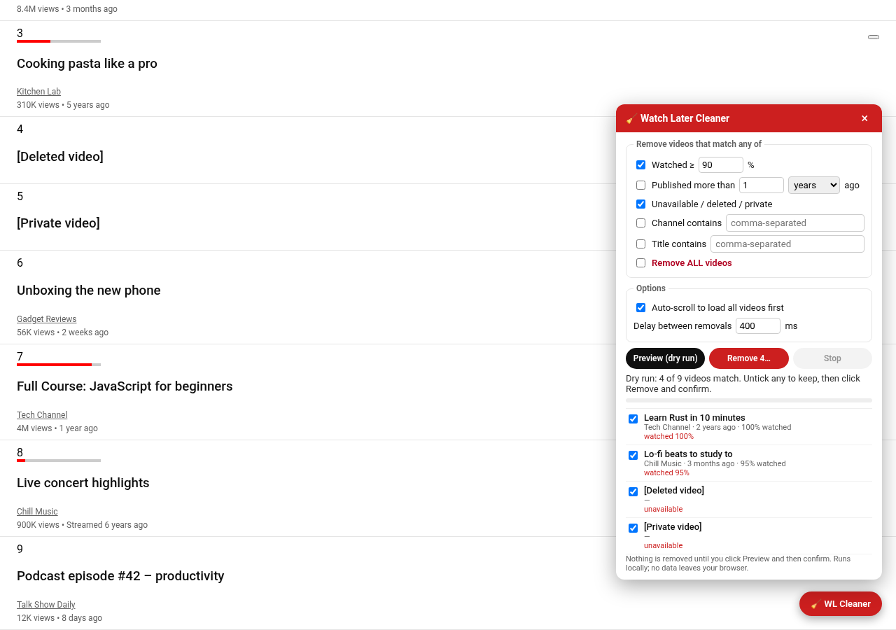

# Watch Later Cleaner

A Chrome extension (Manifest V3) that cleans up your YouTube **Watch Later** playlist
(`https://www.youtube.com/playlist?list=WL`) — remove watched, old, unavailable, filtered, or all videos,
with a dry-run preview before anything is removed.



## Features

- **Remove watched videos** — red progress bar ≥ a configurable threshold (default **90%**).
- **Remove old videos** — published more than *N* days / weeks / months / years ago (parsed from the
  "3 years ago" text YouTube shows; English UI only — items whose age can't be read are never matched).
- **Remove unavailable videos** — `[Deleted video]`, `[Private video]` and similar bracketed entries with no channel.
- **Channel / title keyword filters** — comma-separated, case-insensitive "contains" matching.
- **Remove all.**
- Criteria are combined with **OR** (a video is removed if it matches any enabled criterion).
- **Dry run first:** *Preview* shows the count and the list of matched videos (with the reason each matched).
  Untick anything you want to keep. *Remove* then needs a second **Confirm** click.
- Removal works by **simulating the UI**: each item's **⋮** menu → **Remove from Watch later**, with a configurable
  delay between removals (default **400 ms**), a progress bar/counter and a **Stop** button.
  It verifies each item actually disappeared and aborts after 3 consecutive failures.
- **Auto-scroll** loads the whole playlist before matching (optional).
- **Localization:** the menu entry is found by its English text, then by a localized "remove" verb
  (≈25 languages), then by its trash-can icon, and finally by its menu position (configurable, default 3rd; set 0 to disable).
- **Private and minimal:** no YouTube API key, no network requests, no analytics, no remote code.
  Permissions: `storage` (to remember your settings) and host access to `https://www.youtube.com/*` only.

## Install (unpacked)

1. Download `watch-later-cleaner.zip` (or build it — see below) and unzip it into a folder.
   Alternatively, use the `extension/` folder of this repo directly.
2. Open `chrome://extensions`.
3. Turn on **Developer mode** (top-right).
4. Click **Load unpacked** and select the unzipped folder (the one that contains `manifest.json`).
5. Optional: pin **Watch Later Cleaner** from the puzzle-piece menu.

## Usage

1. Open your Watch Later playlist: <https://www.youtube.com/playlist?list=WL> (or click **Open Watch Later** in the popup).
2. Click the red **🧹 WL Cleaner** button in the bottom-right corner of the page (or **Show cleaner panel** in the popup).
3. Pick criteria (watched ≥ %, older than, unavailable, channel/title keywords, or remove all).
4. Click **Preview (dry run)**. The extension scrolls to load all videos and lists what would be removed. Nothing is removed yet.
5. Untick any video you want to keep, click **Remove N…**, then **Confirm: remove N**.
6. Watch the progress counter; click **Stop** at any time (it stops after the current item).

Settings are shared between the popup and the on-page panel and saved in `chrome.storage.sync`.

Tips: if YouTube starts lagging or items aren't removed, increase the delay (e.g. 800–1000 ms).
YouTube hides unavailable videos by default; use the playlist's **⋮ → Show unavailable videos** first if you want to remove them.

## Development

Requires Node.js 20+ and Python 3 with Pillow (only for regenerating icons).

```bash
npm install
npm test          # vitest + jsdom: parsing, filtering, simulated menu removal, panel flow
npm run lint      # eslint
npm run build     # -> dist/watch-later-cleaner.zip and dist/extension/
npm run e2e       # headless Chrome smoke test against the local fixture (needs CHROME_PATH or /usr/bin/google-chrome)
npm run icons     # regenerate extension/icons/*.png
```

Layout:

```
extension/            the extension (plain JS, loaded as-is — no bundler)
  manifest.json
  lib/settings.js     defaults, validation, chrome.storage
  lib/parse.js        selectors + parsing of ytd-playlist-video-renderer items
  lib/filters.js      pure matching logic
  lib/remover.js      auto-scroll, ⋮ menu automation, removal loop
  content/panel.js    injected Shadow-DOM panel
  content/main.js     mounts the panel on the Watch Later page (handles YouTube SPA navigation)
  popup/              toolbar popup (settings + shortcuts)
test/fixtures/        hand-written sample Watch Later markup + a fake ⋮ menu used by tests
scripts/              build, e2e smoke test, icon generator
```

The e2e smoke test serves the fixture at the real Watch Later URL via request interception (all other network
requests are blocked), so it never talks to YouTube.

## Limitations

- Relies on YouTube's page structure (`ytd-playlist-video-renderer`, the resume-playback progress bar, the ⋮ popup menu).
  YouTube changes its DOM from time to time; if that happens, selectors in `extension/lib/parse.js` and
  `extension/lib/remover.js` may need updating. The removal loop verifies each removal and stops after repeated failures.
- "Older than" uses the video's **publish** date as shown on the page; YouTube doesn't show when you *added* a video.
  Age parsing only understands English relative dates.
- Watch progress is only known for videos YouTube shows a red progress bar for.
- Removing hundreds of videos takes a while (delay × count) — that's intentional to avoid tripping YouTube.

## License

MIT
